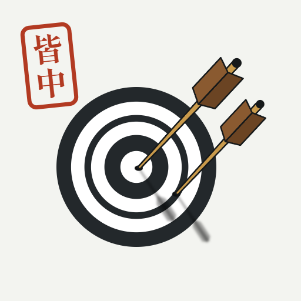
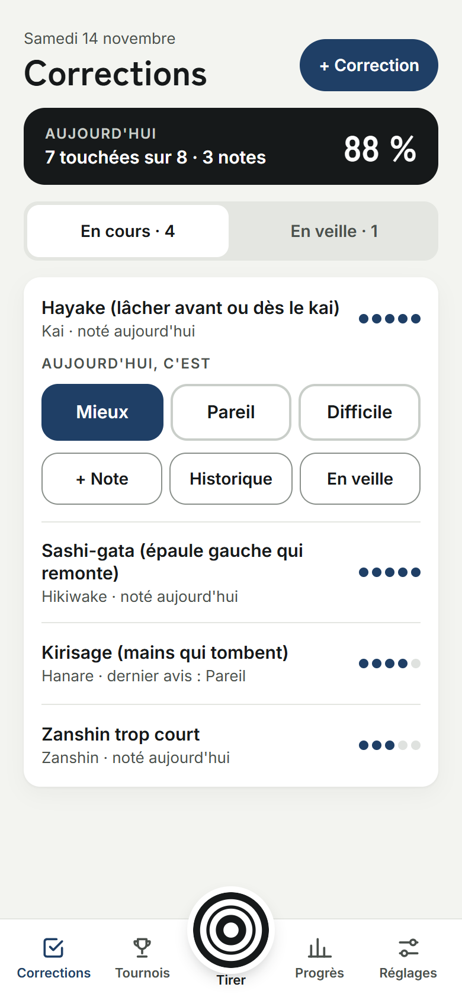
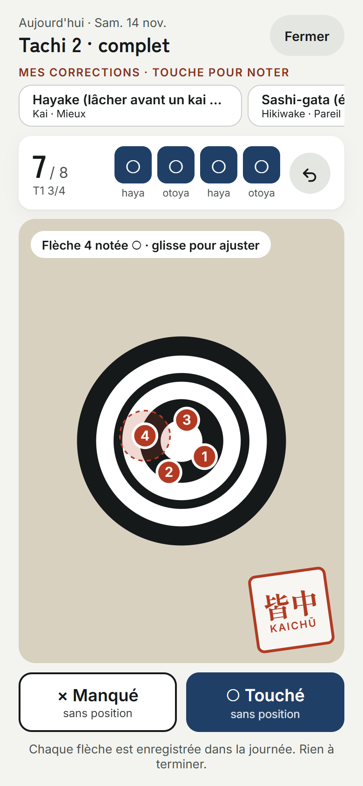
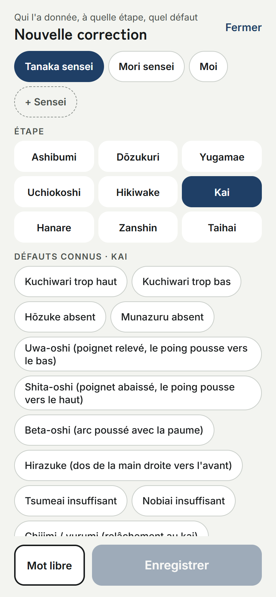
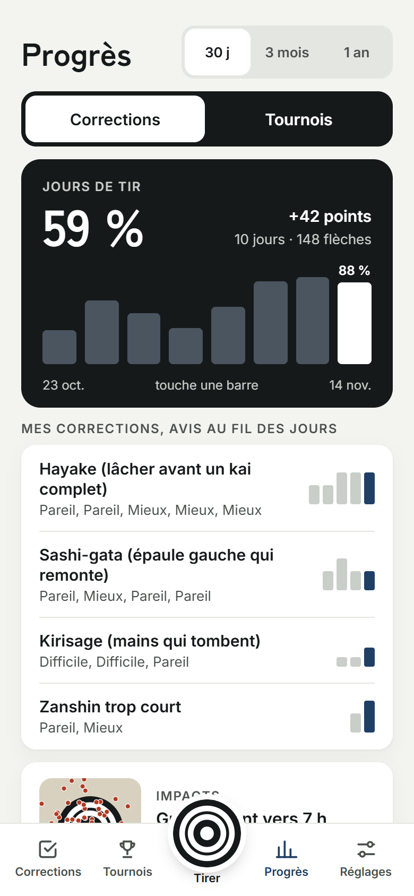

<p align="center">
  
</p>

<h1 align="center">Tekichū · 的中</h1>

<p align="center">
  <b>Le carnet d'entraînement de kyudo qui tient dans la poche.</b><br>
  Note tes flèches, suis tes corrections, regarde ta progression. Sans compte, sans clavier, hors ligne.
</p>

<p align="center">
  <a href="https://tekichu.pages.dev"></a>
</p>

<p align="center">
  
  
  
  
</p>

---

<p align="center">
  
  
  
  
</p>

> *Tekichū* (的中) : la flèche qui atteint la cible.

## Ce que fait l'app

- **Corrections** · L'écran d'ouverture. Tu ajoutes une correction en trois touches : qui l'a donnée (toi ou un sensei), à quelle étape du hassetsu, quel défaut. Chaque jour, tu dis si c'est *Mieux*, *Pareil* ou *Difficile*, et tu peux ajouter une note. Une correction ne se « termine » jamais : elle passe *en veille*, et se reprend quand il faut.
- **Tirer** · Accessible à tout moment par la cible au centre. ○ ou × pour chaque flèche, et si tu veux, un doigt sur la mato pour placer l'impact. Un tachi entièrement touché fait apparaître le sceau **皆中** (kaichū).
- **Tournois** · Un menu à part : tu démarres un tournoi, tu notes tes résultats et tes impressions.
- **Progrès** · Deux parties, corrections et tournois : taux de touche par jour, évolution de chaque correction, groupement des impacts, comparaison haya / otoya.

Il n'y a pas de « séance » à démarrer ni à terminer : un jour où tu tires est une journée de travail, elle se crée toute seule.

## Sans clavier

Les défauts courants sont proposés par étape (ashibumi, dōzukuri, yugamae, uchiokoshi, hikiwake, kai, hanare, zanshin, taihai), dans l'ordre du geste. Les termes japonais ont été vérifiés sur le [dictionnaire de la fédération japonaise (ANKF)](https://www.kyudo.jp/howto/terminology.html).

## Tes données

Tout reste **sur ton appareil**, dans le stockage du navigateur : pas de compte, pas de serveur. Les Réglages permettent de télécharger une sauvegarde et de la restaurer, par exemple pour changer de téléphone.

## Installer

Ouvre l'app dans le navigateur du téléphone, puis « Ajouter à l'écran d'accueil ». Elle fonctionne ensuite hors ligne.

## Développer

```bash
npm install
npm run dev        # http://localhost:5183
npm run typecheck
npm run build      # produit dist/
```

| Dossier | Contenu |
| --- | --- |
| `src/screens/` | Un fichier par écran |
| `src/store.ts` | L'état de l'app et son enregistrement local |
| `src/faults.ts` | Les étapes du hassetsu et les défauts connus |
| `src/components/Mato.tsx` | La cible tactile |
| `icones.html` | Le dessin de l'icône (SVG), exporté par `npm run icons` |
